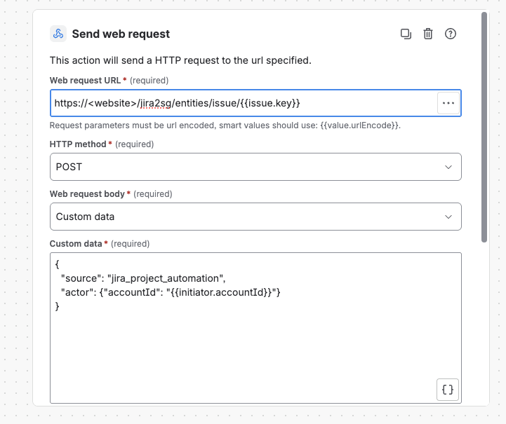
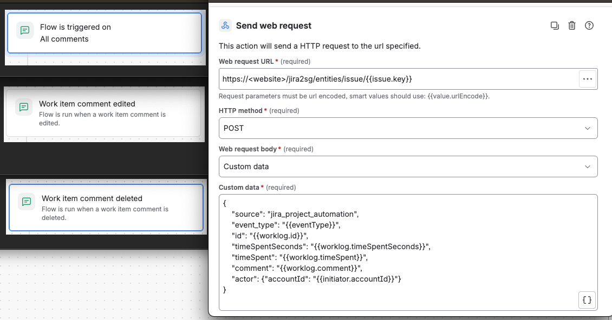
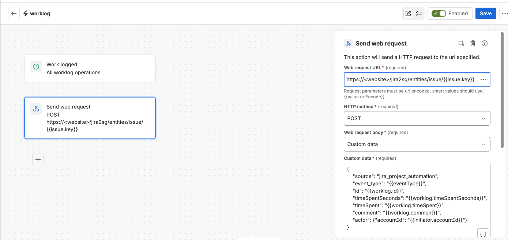
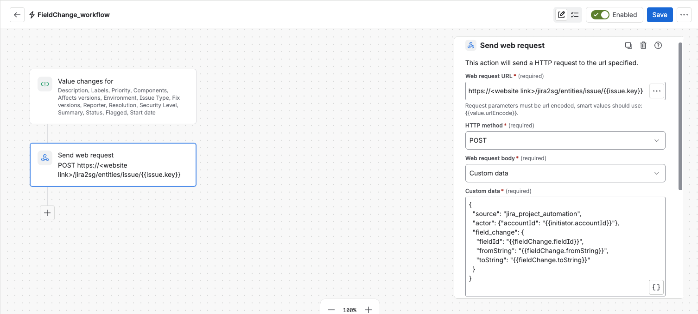

.. _jira_project_automation:

Jira Project Automation
=======================

The Jira Bridge can use Jira automation rules to synchronize changes from Jira
with Flow Production Tracking (FPTR). This allows a Jira project administrator
to configure synchronization for a project without creating a site-wide Jira
webhook.

Each rule sends an HTTP request to the bridge when an issue, comment, or worklog
changes. The bridge retrieves the required Jira data and processes the change
using the same Generic Syncer as a Jira webhook. The existing entity mappings,
sync directions, and loop protection continue to apply.

This guide describes how to set up the rules, verify that they are working, and
resolve common problems.

.. important::

   Use **either Jira Project Automation or a Jira site webhook** for a project,
   not both. Configuring both can process the same change twice and cause
   conflicting updates in FPTR. If the project already uses a webhook, you do
   not need to configure automation rules.

.. contents:: On this page
   :local:
   :depth: 2

Requirements
------------

Before creating automation rules, make sure the Jira Bridge and Generic Syncer
are configured. If you have not set up the bridge, follow the :doc:`quickstart`
and :doc:`generic_syncer` guides first.

.. list-table::
   :header-rows: 1
   :widths: 29 71

   * - Requirement
     - Configuration
   * - Running bridge
     - Start ``webapp.py`` or ``service.py``. Jira must be able to reach the
       bridge endpoint, and the bridge must be able to access the Jira API.
   * - Generic Syncer
     - Configure ``sg_jira.EntitiesGenericSyncer`` in ``settings.py`` and
       define the issue types and fields to synchronize.
   * - Jira fields
     - Make sure **Sync In FPTR**, **Shotgun Type**, **Shotgun ID**, and
       **Shotgun URL** are available on the relevant Jira issue screens.
   * - FPTR project
     - Set the FPTR project's **Jira Key** field to the corresponding Jira
       project key.
   * - Issue selected for syncing
     - Set **Sync In FPTR** to ``True`` on the issues you want to sync.
   * - Comment and worklog mapping (optional)
     - Add ``Note`` (comments) and ``TimeLog`` (worklogs) entries to
       ``entity_mapping`` if you want to sync those changes. Enable
       ``sync_deletion_direction`` for either entity if deletions should sync.
   * - Jira permissions
     - Use an account that can manage project automation rules. The Jira
       account configured for the bridge must be able to access the relevant
       issues, comments, and worklogs.

.. note::

   Deleting comments and worklogs in Jira does **not** delete the corresponding
   FPTR entities unless ``sync_deletion_direction`` is configured for the
   ``Note`` or ``TimeLog`` mapping. Deletion sync is disabled by default.

Set up a Jira automation rule
-----------------------------

All rules use the same web request configuration. The trigger and JSON body
depend on the change you want to synchronize.

#. In Jira, open your project and go to **Project settings > Automation**.
#. Select **Create rule** and choose the trigger from the sections below.
#. Add an **Issue fields condition**: set **Sync In FPTR** to ``True``.
   This keeps issues that are not selected for synchronization from reaching
   the bridge.
#. Add the **Send web request** action and configure these settings:

   .. list-table::
      :header-rows: 1
      :widths: 29 71

      * - Setting
        - Value
      * - Web request URL
        - ``https://<bridge-host>/jira2sg/<settings_name>/issue/{{issue.key}}``
      * - HTTP method
        - ``POST``
      * - Headers
        - ``Content-Type: application/json``
      * - Web request body
        - **Custom data**

#. Copy the **Custom data** JSON for your chosen trigger from the next
   section.
#. Give the rule a descriptive name, then save and enable it.

For example, if the bridge is available at ``bridge.example.com`` and your
Generic Syncer is named ``entities``, the web request URL is:

.. code-block:: text

   https://bridge.example.com/jira2sg/entities/issue/{{issue.key}}

Replace ``<bridge-host>`` with the address of the bridge and
``<settings_name>`` with its syncer settings name (often ``entities``).
Leave ``{{issue.key}}`` unchanged. Jira replaces it with the issue key when
the rule runs.

.. note::

   The **Custom data** examples use Jira *smart values*, enclosed in double
   braces (``{{...}}``). Do not replace them with fixed values.
   ``{{initiator.accountId}}`` identifies the user who made the change and is
   required for the bridge's loop protection.

Configure the triggers
----------------------

Create only the rules required for your project. Jira rules normally have one
trigger, so issue creation and update, for example, require separate rules.

Sync issues
~~~~~~~~~~~

Use **Issue created** to sync new issues and **Issue updated** to sync changes
to existing issues. Create a rule for each trigger you need. Both rules use
the following JSON in **Custom data**:

.. code-block:: json

   {
     "source": "jira_project_automation",
     "actor": {
       "accountId": "{{initiator.accountId}}"
     }
   }

The bridge retrieves the Jira issue and synchronizes **all mapped fields**.
This is the recommended setup for most projects and does not require changes
to the automation rule when field mappings are updated.

   Send web request configuration for full issue synchronization.

.. note::

   Full sync updates all mapped fields, including fields that did not change
   in Jira. If people also edit the same fields in FPTR, consider
   :ref:`partial issue sync <advanced_partial_sync>` instead.

Sync comments
~~~~~~~~~~~~~

Create rules for the comment operations you want to synchronize. Depending on
your Jira interface, the triggers may be named **All comments**,
**Work item comment edited**, and **Work item comment deleted**.

For each comment rule, use this **Custom data**:

.. code-block:: json

   {
     "source": "jira_project_automation",
     "actor": {
       "accountId": "{{initiator.accountId}}"
     },
     "event_type": "{{eventType}}",
     "id": "{{comment.id}}"
   }

The bridge uses the comment ID to identify the corresponding FPTR ``Note``.
For a comment that still exists, it retrieves the current data from Jira.

.. list-table:: Supported comment events
   :header-rows: 1
   :widths: 43 57

   * - Jira change
     - ``event_type`` value
   * - Comment added
     - ``comment_created``
   * - Comment edited
     - ``comment_updated``
   * - Comment deleted
     - ``comment_deleted``

   Jira comment triggers. Choose the trigger for each event you want to sync.

.. note::

   ``{{eventType}}`` must resolve to one of the event names in the table. If
   your Jira rule does not provide the expected value, use a separate rule
   for each operation and enter the corresponding value directly, for
   example ``"event_type": "comment_deleted"``.

   The JSON property is named ``event_type``, not ``eventType``.

Sync worklogs
~~~~~~~~~~~~~

Use the **Work logged** trigger with **All worklog operations** if your Jira
version offers it and supplies the event type. Otherwise, configure separate
rules for worklog creation, updates, and deletion.

Use this **Custom data**:

.. code-block:: json

   {
     "source": "jira_project_automation",
     "actor": {
       "accountId": "{{initiator.accountId}}"
     },
     "event_type": "{{eventType}}",
     "id": "{{worklog.id}}"
   }

The bridge uses the worklog ID to identify the corresponding FPTR
``TimeLog``. For a worklog that still exists, it retrieves the current
values from Jira.

.. list-table:: Supported worklog events
   :header-rows: 1
   :widths: 43 57

   * - Jira change
     - ``event_type`` value
   * - Worklog created
     - ``worklog_created``
   * - Worklog updated
     - ``worklog_updated``
   * - Worklog deleted
     - ``worklog_deleted``

   Work logged trigger with the Send web request action.

.. note::

   If ``{{eventType}}`` is not resolved to a supported value, create one rule
   per operation and use the literal value from the table.

   The payload can also include ``timeSpentSeconds``, ``timeSpent``, and
   ``comment`` as optional data for deleted worklogs. Here, ``comment`` means
   the worklog note, not a Jira issue comment. For comment deletions, an
   optional ``body`` value can likewise provide a snapshot. The bridge
   normally reads current values from Jira, so these fields are not needed
   for regular create or update events.

.. _advanced_partial_sync:

Sync individual issue fields (optional)
---------------------------------------

By default, an issue rule synchronizes every mapped field. If you want to
synchronize only the field that changed, use the **Field value changed**
trigger instead of **Issue updated**.

This is useful when the same field can be edited in both Jira and FPTR, or
when an issue contains many mapped fields.

#. Create a new rule with the **Field value changed** trigger.
#. Choose the fields to watch. Make sure they are included in the bridge's
   ``field_mapping``.
#. Add the **Sync In FPTR = True** condition and the same **Send web request**
   settings described above.
#. Paste the following JSON into **Custom data**:

   .. code-block:: json

      {
        "source": "jira_project_automation",
        "actor": {
          "accountId": "{{initiator.accountId}}"
        },
        "field_change": {
          "fieldId": "{{fieldChange.fieldId}}",
          "fromString": "{{fieldChange.fromString}}",
          "toString": "{{fieldChange.toString}}"
        }
      }

#. Save and enable the rule.

``fieldId`` identifies the changed Jira field. The bridge reads its current
value from Jira and synchronizes it only if the field appears in
``field_mapping``. You can also enter a fixed field ID, such as ``summary``,
if a rule watches only one field.

The optional ``field_change`` values ``fromString`` and ``toString``
describe the previous and new values. They are not required for
synchronization.

The optional ``field`` is the name of the changed field, and defaults to
``fieldId``. It matters for one change only: a change of **parent**. A site
webhook names that change ``IssueParentAssociation``, and the bridge uses the
name to sync the parent. For a rule which watches the parent, enter both values
as fixed text:

.. code-block:: json

   "field_change": {
     "fieldId": "parent",
     "field": "IssueParentAssociation"
   }

The parent must be mapped in ``field_mapping`` to be synced.

   Field value changed trigger for partial issue synchronization.

.. warning::

   Partial sync requires **Field value changed**. Do not use the
   **Issue updated** trigger with ``{{fieldChange.fieldId}}`` because Jira
   may not populate the field change smart value for that trigger.

   Do not run an **Issue updated** full-sync rule alongside a
   **Field value changed** rule for the same updates. Both rules would
   process the same change. If necessary, use **Issue created** for full
   initial sync and **Field value changed** for later updates.

Test the configuration
----------------------

After enabling a rule, confirm that Jira can send the request and that the
bridge completes the sync.

#. Open an issue in the linked Jira project and set **Sync In FPTR** to
   ``True``.
#. Make a change that matches the rule's trigger: update an issue, add a
   comment, log time, or change a watched field.
#. Open the rule's **Audit log** in Jira Automation.
#. Check that the rule ran and the web request returned **HTTP 200**.
#. Check the bridge log and the associated entity in FPTR to confirm that
   the change was synchronized.

Repeat the test for any other event types you enabled, including deletion
when applicable. Also check that issues with **Sync In FPTR** set to
``False`` are not synchronized.

.. important::

   **HTTP 200 means the bridge received the request.** It does not confirm
   that the change was applied in FPTR. Use the bridge log to check the
   synchronization result.

Troubleshooting
---------------

Start with the Jira rule's **Audit log**. If the request reached the bridge,
check the bridge log for details about mapping, permissions, or the entity
that was processed.

.. list-table::
   :header-rows: 1
   :widths: 41 59

   * - Problem
     - What to check
   * - The rule does not run
     - Check that it is enabled, the trigger matches the change, and
       **Sync In FPTR** is ``True``.
   * - Request fails or times out
     - Check the bridge URL, HTTPS access, bridge service, and firewall
       settings. Jira Cloud must be able to reach the bridge.
   * - ``actor is required`` or ``actor.accountId is empty``
     - Include ``"actor": {"accountId": "{{initiator.accountId}}"}``.
       The rule must have a user initiator.
   * - ``contains an unexpanded Jira smart value``
     - Check the smart value and its trigger. For example,
       ``{{comment.id}}`` is available in comment rules.
   * - ``has unexpected keys``
     - Compare the JSON with the examples above. Use ``event_type`` rather
       than ``eventType``.
   * - ``Unsupported event_type``
     - Check that ``{{eventType}}`` resolves to a supported event name. If
       needed, configure a rule with a literal ``event_type`` value.
   * - Jira issue, comment, or worklog not found
     - Check that the URL ends with ``{{issue.key}}``, the IDs are expanded,
       and the bridge account can access the entity.
   * - ``Note`` or ``TimeLog`` is not configured for syncing
     - Add the corresponding entry to ``entity_mapping``.
   * - Issue ``has not been flagged as synced``
     - Set **Sync In FPTR** to ``True`` on the Jira issue.
   * - Sync direction only allows FPTR to Jira
     - Configure ``sync_direction`` as ``both_way`` or ``jira_to_sg`` on the
       applicable mapping.
   * - Deletion is disabled
     - Configure ``sync_deletion_direction`` for the ``Note`` or
       ``TimeLog`` mapping.
   * - ``created by the bridge user``
     - This is expected. The bridge ignores its own Jira changes to avoid
       synchronization loops.
   * - HTTP 200, but no update in FPTR
     - Check the bridge log, project **Jira Key**, **Sync In FPTR** field,
       entity mapping, and sync direction.

An HTTP ``400`` response indicates a mistake in the rule: an invalid payload, a
value of the wrong type, a smart value Jira could not fill in, or an Issue,
comment or worklog which does not exist. An HTTP ``502`` response means that
Jira itself failed (authentication, rate limiting or an outage) while the bridge
read the data of the request: the rule is fine, try again and check the
bridge log, which has the details. An HTTP ``500`` response indicates that the
bridge could not complete server-side processing. See :doc:`debugging` for
information about bridge logging.

.. _automation_vs_webhooks:

Automation or a site webhook?
-----------------------------

Both approaches use the same Generic Syncer and produce the same result for
supported events. Choose the one that best fits how your Jira projects are
managed.

.. list-table::
   :header-rows: 1
   :widths: 25 37 38

   * -
     - Project automation
     - Site webhook
   * - Setup
     - A project administrator creates rules for each project.
     - A Jira administrator configures a webhook for the site.
   * - Event selection
     - Triggers and conditions determine which changes are sent.
     - Event types and JQL determine which changes are sent.
   * - Issue field updates
     - Full sync by default; optional field-level rules.
     - Field-level changes are included in webhook events.
   * - Troubleshooting
     - Jira automation audit log and bridge log.
     - Webhook delivery details and bridge log.
   * - Jira API requests
     - The bridge retrieves the affected Jira data after each event.
     - The webhook already includes event data.

Project automation is a good choice when you administer individual projects
or need conditions specific to a project. Site webhooks are simpler when a
Jira administrator manages synchronization for many projects.

There are a few limitations to keep in mind:

* **Issue deletion** is not supported by either method.
* **Deleted comment replies** may remain in FPTR when project automation is
  used. After Jira deletes a reply, the bridge may no longer be able to
  identify its parent comment. Site webhook events contain the information
  required to recognize deleted replies.

Network access
--------------

Jira Cloud sends automation requests from Atlassian's infrastructure. The
bridge endpoint must therefore be reachable from Jira, typically through
HTTPS. If the bridge is behind a firewall, configure access according to
Atlassian's published outbound IP guidance.

The bridge also needs access to the Jira REST API to retrieve issue,
comment, and worklog data.

For a local development environment, see **Testing on a Machine Not
Accessible to Jira** in :doc:`debugging`.
