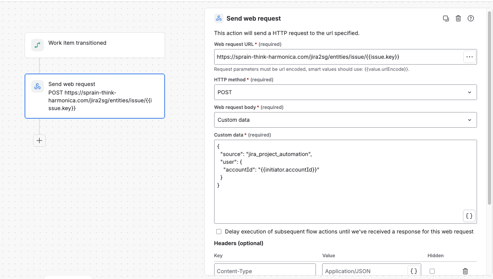

.. _jira_project_automation:

Jira Project Automation
#######################

Project administrators can sync Jira → Flow Production Tracking (FPTR) with
**automation rules** when site-level webhooks are not available. Each rule sends
a small JSON body; the bridge turns it into the same events site webhooks use.

How to think about it (for rule authors)
****************************************

You configure **two things in Jira**, not in the bridge:

1. **When** — the rule **trigger** (*Field value changed*, *Comment added*, …).
2. **What to tell the bridge** — **Custom data** JSON with ``trigger`` (must
   match the intent of that Jira trigger) and **smart values** where Jira fills
   in ids at run time.

You **never look up** comment or worklog ids in the Jira UI. You paste Jira
**smart value** placeholders; Jira replaces them when the rule runs.

.. list-table::
   :header-rows: 1
   :widths: 28 72

   * - You configure in Jira
     - Meaning
   * - Rule trigger
     - *When* the web request fires
   * - ``trigger`` in JSON
     - *What* the bridge should sync (must align with the rule — see table below)
   * - ``{{issue.key}}`` in the URL
     - Which Issue (always from smart values)
   * - ``{{comment.id}}`` / ``{{worklog.id}}`` in JSON
     - Which comment/worklog (only for comment/worklog rules)
   * - ``{{initiator.accountId}}`` in ``actor``
     - Who caused the change (avoids sync loops)

HTTP (every rule)
=================

.. code-block:: text

   POST https://<bridge-host>/jira2sg/<settings_name>/issue/{{issue.key}}
   Content-Type: application/json

**Send web request:** method **POST**, body **Custom data**.

Replace ``<settings_name>`` with your Generic Syncer settings key (often
``entities``). Leave ``{{issue.key}}`` exactly as written.

**Recommended condition:** *Issue fields* → *Sync In FPTR* **equals** ``True``.

Minimum JSON (every rule)
=========================

.. code-block:: json

   {
       "source": "jira_project_automation",
       "trigger": "<see tables below>",
       "actor": {"accountId": "{{initiator.accountId}}"}
   }

Only the keys documented on this page are allowed. There is no API version field.

Pick a recipe (copy-paste)
**************************

Issue — full sync
=================

.. list-table::
   :header-rows: 1
   :widths: 35 65

   * - Jira rule trigger
     - Custom data
   * - **Issue created**
     - ``trigger``: ``issue.created`` (+ ``source``, ``actor``)
   * - **Issue updated** (resync all mapped fields)
     - ``trigger``: ``issue.updated`` (+ ``source``, ``actor``)

Example (*Issue created*)::

    {
        "source": "jira_project_automation",
        "trigger": "issue.created",
        "actor": {"accountId": "{{initiator.accountId}}"}
    }

Issue — sync only fields that changed (recommended default)
===========================================================

Use Jira trigger **Field value changed** (limit to FPTR-mapped fields).

**Simplest body (recommended)** — you do **not** pass field names or ids. The
bridge reads the latest change from Jira’s API (same fields as in that edit)::

    {
        "source": "jira_project_automation",
        "trigger": "issue.field_changed",
        "actor": {"accountId": "{{initiator.accountId}}"}
    }

That three-field payload is intentional: ``trigger`` tells the bridge *field-level*
sync; Jira’s trigger already decided *when*; the bridge discovers *which* fields
changed.

**Single field from the trigger (optional)** — if you prefer to name the field
explicitly via ``{{fieldChange}}``::

    {
        "source": "jira_project_automation",
        "trigger": "issue.field_changed",
        "actor": {"accountId": "{{initiator.accountId}}"},
        "field_change": {
            "field": "{{fieldChange.field.name}}",
            "fieldId": "{{fieldChange.field.id}}"
        }
    }

If you include ``field_change`` but omit ``trigger``, the bridge infers
``issue.field_changed``.

Do **not** use ``{{#changelog.changedFields}}`` in Project Automation — that
block is empty there.

Comments → FPTR Notes
=====================

Create **one rule per** Jira trigger. The ``trigger`` value must match the event
(added / edited / deleted).

.. list-table::
   :header-rows: 1
   :widths: 32 68

   * - Jira rule trigger
     - ``trigger`` in JSON
   * - Comment added
     - ``comment.added``
   * - Comment edited
     - ``comment.edited``
   * - Comment deleted
     - ``comment.deleted``

Example (*Comment added*) — copy as-is; Jira substitutes ``{{comment.id}}`` when
the rule runs::

    {
        "source": "jira_project_automation",
        "trigger": "comment.added",
        "comment_id": "{{comment.id}}",
        "actor": {"accountId": "{{initiator.accountId}}"}
    }

Equivalent shorthand::

    {
        "source": "jira_project_automation",
        "trigger": "comment.added",
        "comment": "{{comment.id}}",
        "actor": {"accountId": "{{initiator.accountId}}"}
    }

The bridge loads the full comment from Jira (including **replies** via
``parentId``). You only pass the smart value placeholder.

Worklogs → FPTR TimeLogs
========================

Same pattern as comments. Requires ``TimeLog`` in Generic Syncer ``entity_mapping``.

.. list-table::
   :header-rows: 1
   :widths: 32 68

   * - Jira rule trigger
     - ``trigger`` in JSON
   * - Work logged
     - ``worklog.added``
   * - Worklog updated
     - ``worklog.updated``
   * - Worklog deleted
     - ``worklog.deleted``

Example (*Work logged*)::

    {
        "source": "jira_project_automation",
        "trigger": "worklog.added",
        "worklog_id": "{{worklog.id}}",
        "actor": {"accountId": "{{initiator.accountId}}"}
    }

Or ``"worklog": "{{worklog.id}}"`` instead of ``worklog_id``.

Webhook vs automation
*********************

Use **one** per project, not both.

.. warning::
   Running both doubles sync traffic and can race on the same FPTR entity.

Before you start
****************

.. list-table::
   :header-rows: 1
   :widths: 35 65

   * - Requirement
     - How to check
   * - Bridge running and reachable from Jira
     - Same as :ref:`Jira Webhook`
   * - ``EntitiesGenericSyncer`` in ``settings.py``
     - See :doc:`generic_syncer`
   * - *Sync In FPTR* on Issue screen + test Issue checked
     - See :ref:`Jira Configuration <entity-sync-jira-config>`
   * - FPTR project linked (Jira Key)
     -
   * - ``Note`` / ``TimeLog`` in ``entity_mapping`` (for comment/worklog rules)
     -

Conditions
**********

Use `Jira automation conditions
<https://support.atlassian.com/cloud-automation/docs/jira-automation-conditions/>`_:

* **Issue fields** — *Sync In FPTR* = ``True``
* **Smart values** (optional) — exclude the bridge Jira user via
  ``{{initiator.accountId}}``

Setup checklist
***************

1. **Project settings → Automation → Create rule**
2. Trigger from the tables above
3. Condition: *Sync In FPTR* = ``True``
4. **Send web request** — URL and Custom data from this page
5. Audit log: HTTP 200 = received (see bridge logs for actual sync)

   Body type must be **Custom data**.

.. _jira_automation_advanced:

Advanced — explicit field list
******************************

Rare; prefer ``issue.field_changed`` with the minimal body::

    {
        "source": "jira_project_automation",
        "trigger": "issue.field_changed",
        "actor": {"accountId": "{{initiator.accountId}}"},
        "changed_fields": [
            {"field": "Summary", "fieldId": "summary"},
            {"field": "Description", "fieldId": "description"}
        ]
    }

For developers
**************

* Normalization: :func:`sg_jira.jira_automation_payload.normalize_automation_request`
* Trigger map: :data:`sg_jira.jira_automation_payload.TRIGGER_TO_WEBHOOK_EVENT`
* Full Issue sync uses a server-built changelog entry (*Sync In FPTR*), not a
  client flag. :func:`~sg_jira.jira_automation_payload.strip_untrusted_automation_flags`
  runs on every ``jira2sg`` request.
* ``webhook_event`` in JSON is deprecated; use ``trigger``.
* Handler: :class:`~sg_jira.handlers.entities_generic_handler.EntitiesGenericHandler`

Network access
**************

Same requirements as :ref:`Jira Webhook` (HTTPS, bridge ↔ Jira API).
